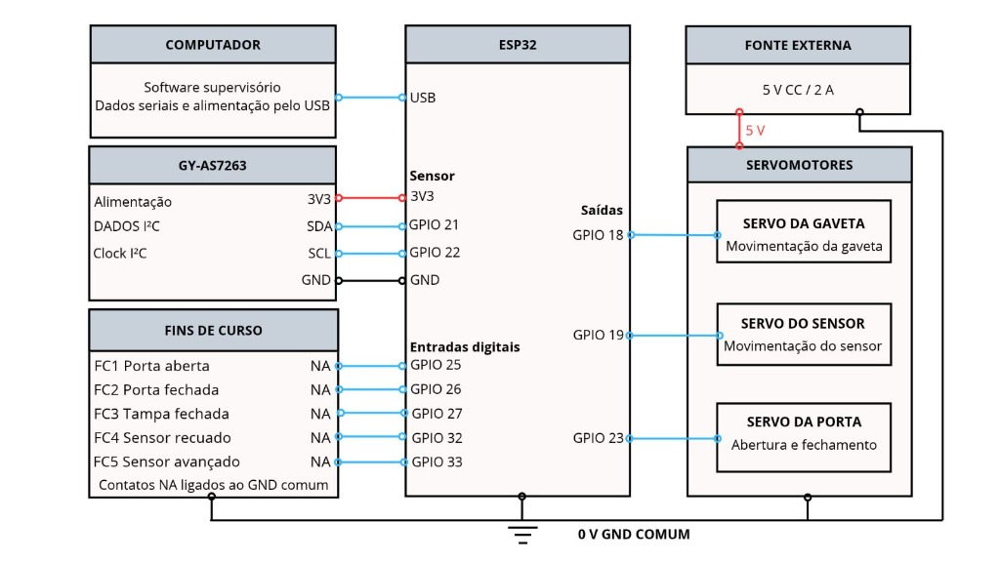
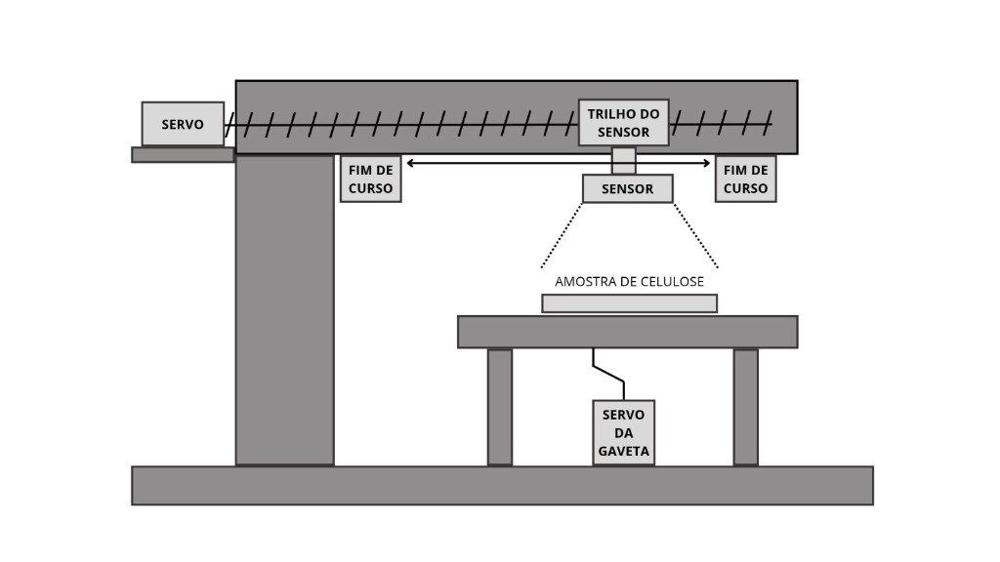
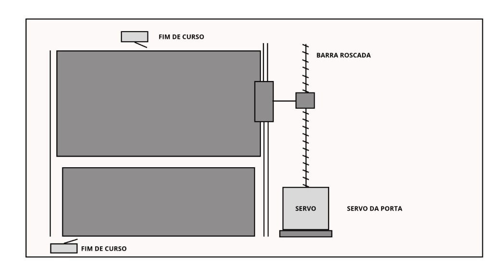

# SPECTRUM-LAB PRO v4.17.6 — Protótipo NIR para Estimativa do Número Kappa em Polpa Kraft

Repositório oficial do **Trabalho de Conclusão de Curso (TCC)** em **Técnico em Automação Industrial — SENAI Três Lagoas/MS (2026)**.

**Autores:**
- Davi Baracat Gonçalves
- Kauê Uã Carvalho de Alencar
- Mateus Ferreira da Silva

---

## Visão Geral do Projeto

O **SPECTRUM-LAB PRO** é um protótipo automatizado de bancada para leitura óptica de amostras secas de celulose e estimativa do **número Kappa** em polpa Kraft, fundamentado na espectroscopia no infravermelho próximo (**NIR**, *Near-Infrared Spectroscopy*) por reflectância difusa.

O sistema integra:
1. **Câmara Escura Automatizada em MDF** com acionamento por **3 servomotores** (gaveta da amostra, carro do sensor em barra roscada e porta) e monitoramento de posição por **5 chaves fim de curso**;
2. **Microcontrolador ESP32** comunicando-se via I²C com o sensor espectral de 6 canais **GY-AS7263** (`610`, `680`, `730`, `760`, `810` e `860 nm`) sob o protocolo determinístico **`PLS_ACQ_1`**;
3. **Software Supervisório Multiplataforma (`Python` / `PyQt5`)** com interface gráfica responsiva, auditoria estatística de bateladas (5 varreduras) e modelagem quimiométrica embarcada (**Transformação de Remissão de Kubelka-Munk + SNV Amortecido + Regressão PLS1 via algoritmo NIPALS**).

---

## Estrutura do Repositório

```text
SpectrumLabPro-NIR-Kappa/
├── firmware/
│   └── Firmware_ESP32_4_17_6_Estabilizado/
│       ├── Firmware_ESP32_4_17_6_Estabilizado.ino   # Firmware C++/Arduino do ESP32 (Protocolo PLS_ACQ_1)
│       └── src/                                     # Drivers locais e controle do sensor AS726X
├── supervisorio/
│   ├── main.py                                      # Interface gráfica principal do SPECTRUM-LAB PRO
│   ├── chemometrics.py                              # Motor Quimiométrico (Kubelka-Munk, SNV Amortecido, PLS1 NIPALS)
│   ├── experimental_chemometrics.py                 # Bancada de calibração e validação cruzada Leave-One-Out
│   ├── connection_worker.py                         # Comunicação serial assíncrona (115200 bps) com validação
│   ├── equipment_interlocks.py                      # Intertravamentos de segurança eletromecânica (5 fins de curso)
│   ├── responsive_ui.py                             # Sistema de layout responsivo autoajustável ao monitor
│   ├── database.py / database_manager.py            # Persistência em banco de dados SQLite3
│   ├── pdf_generator.py / batch_reports.py          # Geração de laudos técnicos em PDF e exportação CSV/JSON
│   ├── requirements-linux.txt                       # Dependências Python do supervisório
│   └── assets/                                      # Ícones e recursos visuais da interface
├── modelos/
│   ├── modelo_pls1_km_snv_5_padroes_oficial.json    # Modelo padrão calibrado (R² = 0,9925 | RMSEC = 0,69 Kappa)
│   ├── modelo_pls1_km_snv_4_polpas_kraft.json       # Modelo específico para polpas Kraft não branqueadas
│   └── modelo_pls1_km_snv_7_amostras_expandido.json # Modelo estendido (ε = 0,08)
└── docs/
    └── diagramas/                                   # Diagrama elétrico em blocos e esquemas da estrutura física
```

---

## Arquitetura Eletromecânica e Diagrama em Blocos

### Diagrama Elétrico em Blocos


| Subsistema | Componente | Pinos no ESP32 / Barramento | Função |
| :--- | :--- | :--- | :--- |
| **Sensor Espectral** | Módulo `GY-AS7263` (6 canais: 610–860 nm) | `SDA: GPIO 21` / `SCL: GPIO 22` (3,3 V) | Aquisição óptica por reflectância difusa |
| **Atuadores PWM** | 3 Servomotores (Fonte externa 5 V / 2 A) | `GPIO 18` (Gaveta), `GPIO 19` (Sensor), `GPIO 23` (Porta) | Posicionamento da amostra, varredura e vedação |
| **Sensores Digitais** | 5 Chaves Fim de Curso (`NA` com *pull-up*) | `GPIOs 25, 26, 27, 32 e 33` | Confirmação de posições de porta, tampa e carro |

### Esquemas da Montagem Física
- **Vista Lateral (Carro do Sensor em Barra Roscada e Gaveta da Amostra):**


- **Vista Superior (Mecanismo da Porta e Fins de Curso):**


---

## Protocolo Embarcado `PLS_ACQ_1` e Modelagem Quimiométrica

1. **Estabilização Radiométrica no Firmware (`PLS_ACQ_1`)**:
   - **Pré-aquecimento térmico do LED (*Cold-Start Pre-Warming*)**: 120 ms de estabilização térmica seguidos de leitura de descarte antes da primeira integração;
   - **Sobreamostragem Interna (*2x Oversampling*)**: média de duas integrações consecutivas no sensor `AS7263` (`BANK_2`, ganho `64x`, integração de `700 ms`);
   - **Desacoplamento físico de PWM (`detach`)**: desligamento do sinal PWM dos servomotores logo após o término do movimento, eliminando vibrações mecânicas (*hunting*) e ruído elétrico, atingindo **CV médio de 0,33%** na referência clara (`N = 10`).

2. **Pipeline Quimiométrico (`KM-SNV + PLS1`)**:
   - **Transformação de Remissão de Kubelka-Munk (KM)**:
     $$x_i = F(R_i) = \frac{(1 - R_i)^2}{2 R_i}$$
   - **Variação Normal Padrão Amortecida (*Damped SNV*, $\varepsilon = 0,03$)**:
     $$z_i = \frac{x_i - \bar{x}}{\sqrt{s_x^2 + \varepsilon^2}}$$
   - **Regressão por Mínimos Quadrados Parciais (`PLS1` via algoritmo `NIPALS`, 1 componente latente)**:
     $$\hat{K} = b_0 + \sum_{i=1}^{6} w_i \left(\frac{z_i - \mu_i}{\sigma_i}\right)$$
   - Desempenho experimental nos padrões de referência (Kappa `0,58` a `19,95`): **$R^2 = 0,9925$**, **$\text{RMSEC} = 0,69$ unidade de Kappa** e desvio padrão por batelada de 5 varreduras entre **$0,051$ e $0,145$**.

---

## Como Executar o Software Supervisório

```bash
cd supervisorio
python3 -m venv .venv
source .venv/bin/activate  # No Windows: .venv\Scripts\activate
pip install -r requirements-linux.txt
python3 supervisor_entry.py
```

---

## Licença e Uso Acadêmico

Desenvolvido para fins acadêmicos e didáticos no curso **Técnico em Automação Industrial — SENAI Três Lagoas/MS (2026)**.
